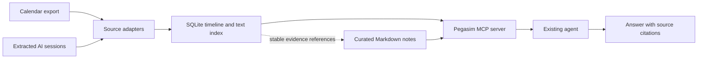

# Pegasim architecture proposal

Pegasim combines CFV's timeline of what happened with the second brain's curated memory of what matters. The timeline can find a scheduled review and the conversation that followed it. Curated memory can carry forward a decision from that conversation and point back to the evidence. Each person runs their own local store.

## What we take from each system

- **From CFV, take the event model and query patterns.** Normalize records from different apps into a common SQLite timeline, with source IDs, timestamps, local dates and source pointers. Use time windows and text search to find relevant events. Adopt CFV's staged refresh and coverage checks when recurring imports make them useful. [CFV architecture](cfv-architecture.md)
- **From the second brain, take conversation capture and explicit curation.** Use the included extractor as the starting point for synthetic AI sessions. Store durable decisions and preferences as Markdown entries with dated evidence references. Start with hand-written entries. If agents need to propose entries later, adapt the inbox and deterministic filing workflow so proposed and curated memory remain distinct. [Second-brain architecture](second-brain-architecture.md)
- **Build the connection in Pegasim.** Give timeline records stable references and use those references in memory notes. Expose both kinds of result through one read-only MCP server so an existing agent can use them in a conversation. Pegasim owns the shared format and can adapt individual components as needed. See the [source inventory](source-inventory.md) for code provenance and upstream reuse terms.

## Data flow

- **Evidence.** Keep source snapshots outside Git. Store normalized events with a type, source-scoped record ID, time and precision, local date, and a pointer to the source. Scope IDs by source instance so identical IDs from different calendars or accounts stay distinct. Keep the normalized timeline and its search index rebuildable. Preserve the distinction between a scheduled event and a record that says it happened.
- **Curated memory.** Each entry states a durable decision or preference, who stated it, when it was recorded, and which event references support it. Markdown is the source of truth for those entries. Retrieval surfaces their evidence alongside the note and identifies a missing source if a reference no longer resolves. A later correction can supersede a note while its earlier evidence remains traceable, subject to the owner's deletion policy.
- **Retrieval.** Follow CFV's connection pattern. An existing agent host launches Pegasim's local MCP server and communicates with it over standard input and output. Start with one read-only tool, `lookup`, that takes a topic and optional date range. It searches the timeline and notes, follows their evidence links, and returns bounded results with source type, timestamp, stable reference and a short excerpt. The host agent uses those results to answer and cite sources. The lookup itself is deterministic, so we can test it separately from the agent's answer.
- **Imports.** Use a small setup command to load the fixtures. A CLI is useful for loading data or debugging the lookup. The first demo runs from the agent's chat through MCP.
- **Data boundaries.** Each person selects which sources to import. Keep private snapshots, excerpts and stores out of the shared repo. The first build exposes only synthetic fixtures. A local MCP server can return excerpts to a host that uses a remote model. Before real imports, agree how access, model processing and deletion work across the input store, derived data and notes. See [Privacy](privacy.md).

## What to build first

Build one local workflow from **a synthetic calendar export and a synthetic AI session**. This exercises CFV's event model and the second brain's capture pipeline in the same run, using inputs that either collaborator can reproduce.

1. **Import.** Read a small calendar fixture and run the existing extractor on a synthetic agent trace. Normalize both outputs into the same SQLite timeline. Create stable evidence references that survive a reimport or rebuild.
2. **Curate.** Add one hand-written Markdown decision linked to the session evidence. Keep it separate from the timeline records and make it discoverable from the same lookup.
3. **Connect one existing agent.** Register the MCP server in an agent host and ask the demo question in chat. Verify that the host discovers `lookup` and calls it, that the tool returns the calendar record, session excerpt and linked note, and that the agent cites those references in its answer.

Example question. “Was Friday's demo review held as planned, and what did we decide about future reviews?” The calendar shows it scheduled for Friday. The session records the owner saying it was moved to Monday and that future reviews will be on Mondays. The expected answer distinguishes the original plan, the reported change, and the standing decision. It cites the calendar and session, and leaves actual attendance unknown.

The first build passes when both fixtures import twice without duplicates or broken references, the agent answers with citations from the MCP tool, and a calendar-only case leaves the outcome unknown. Include an unrelated event in the same time window so the test also checks relevance.

Once this works, try the [memory evaluation](evaluation.md) on private held-out questions and compare with each person's existing workflow. WhatsApp is the next candidate source. Choose between a text export adapter and CFV's compatible iPhone backup importer based on the input both collaborators can use. Add automated curation, richer identity matching, or forecasting when an experiment needs it.
