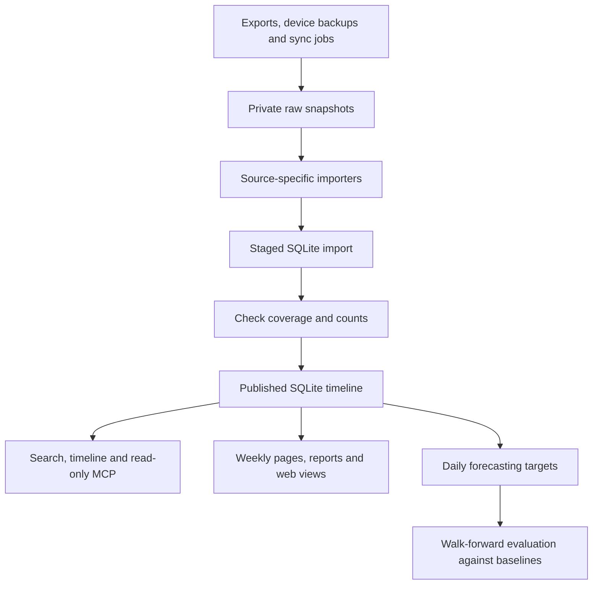

# Tuna's Central Finite Vault architecture

CFV turns personal exports into a searchable timeline. A question such as “What happened around that trip?” can return calendar entries, messages and photo references from the same dates. This review covers the public source at revision `fae1261`. It describes the implementation in that checkout. The private dataset and live deployment were outside the review. [Source revision](https://github.com/tunapro1234/central-finite-vault/tree/fae1261ec830b4de82dece8304395886668dd8bb)

## How it works

1. **Collect.** The CLI registers importers for photos, notes, calendars, contacts, Gmail, WhatsApp, call history and health data, among others. Google Calendar and Gmail have sync jobs. The Gmail importer uses metadata and snippets. WhatsApp reads `ChatStorage.sqlite` from an extracted iPhone backup, with a WhatsApp Business path by default. It records individual messages, associates them with chats and participants, and attaches media references when the files are present. That adapter depends on the backup format and is separate from a chat text export parser. [Importer registry](https://github.com/tunapro1234/central-finite-vault/blob/fae1261ec830b4de82dece8304395886668dd8bb/src/cfv/cli.py) · [WhatsApp adapter](https://github.com/tunapro1234/central-finite-vault/blob/fae1261ec830b4de82dece8304395886668dd8bb/src/cfv/sources/whatsapp.py) · [Gmail adapter](https://github.com/tunapro1234/central-finite-vault/blob/fae1261ec830b4de82dece8304395886668dd8bb/src/cfv/sources/gmail.py)
2. **Normalize.** Each importer maps its records to SQLite `event` rows with a source, external record ID, event type, UTC time, local date, time precision and source-specific fields. Related tables hold people and their aliases, media references, tags and event links. Reimporting replaces the source's rows. This avoids piling up copies, while internal row IDs can change. Some event links are inferred from time proximity, such as a photo taken near a scheduled event. [Schema](https://github.com/tunapro1234/central-finite-vault/blob/fae1261ec830b4de82dece8304395886668dd8bb/src/cfv/schema.sql) · [Import layer](https://github.com/tunapro1234/central-finite-vault/blob/fae1261ec830b4de82dece8304395886668dd8bb/src/cfv/ingest.py) · [Event linking](https://github.com/tunapro1234/central-finite-vault/blob/fae1261ec830b4de82dece8304395886668dd8bb/src/cfv/link.py)
3. **Refresh safely.** The scheduled pipeline backs up the current database, imports into a staging copy and checks for unexpected drops before updating the live database. Source counts and freshness help surface incomplete inputs. Closed days carry revisions so late-arriving records can trigger updates. [Nightly job](https://github.com/tunapro1234/central-finite-vault/blob/fae1261ec830b4de82dece8304395886668dd8bb/src/akis/gunluk.py) · [Day revisions](https://github.com/tunapro1234/central-finite-vault/blob/fae1261ec830b4de82dece8304395886668dd8bb/src/akis/gun.py)
4. **Query and summarize.** SQLite FTS5 provides text search, with filters for dates, event types, people and chats. Read-only MCP tools expose search, time ranges, period digests and photo references. Generated weekly pages, a timeline site and a separate report tree provide other views. The report builder splits dense time ranges until they fit the input budget, then summarizes from the smallest ranges upward. Its stale check uses record count and total length, so an edit that preserves those can be missed. The database stays local in the documented setup. Report generation and photo scoring can send selected inputs to cloud model workers. [MCP tools](https://github.com/tunapro1234/central-finite-vault/blob/fae1261ec830b4de82dece8304395886668dd8bb/src/cfv/mcp_server.py) · [Report tree](https://github.com/tunapro1234/central-finite-vault/blob/fae1261ec830b4de82dece8304395886668dd8bb/src/compact/tree.go) · [Web view](https://github.com/tunapro1234/central-finite-vault/blob/fae1261ec830b4de82dece8304395886668dd8bb/src/site/README.md)
5. **Forecast as a separate experiment.** The prediction package groups WhatsApp messages into sessions and aggregates events into daily targets such as message counts, calendar hours, steps, sleep and contacts. Missing coverage is tracked separately from zero activity. The evaluation uses chronological cutoffs and compares forecasts with simple baselines, including yesterday and the last four matching weekdays. Metrics include mean absolute error for counts and Jaccard overlap for sets. CFV's published GRU experiment reports a test error ratio of `0.72` for calendar hours and `1.00` for sent messages, relative to the best simple baseline. These are upstream results from one person's history. The evaluation docs flag a timing leak in historical task status, which can reflect edits made later. [Evaluation protocol](https://github.com/tunapro1234/central-finite-vault/blob/fae1261ec830b4de82dece8304395886668dd8bb/src/predict/README.md) · [Reported GRU results](https://github.com/tunapro1234/central-finite-vault/blob/fae1261ec830b4de82dece8304395886668dd8bb/src/predict/life2vec/README.md)

## What CFV has that the second brain lacks

- **A shared event timeline across everyday apps.** The second brain is strongest at AI session history, durable decisions and preferences, and curated notes. CFV can query message, photo, calendar and health records in one time window. The second brain has dates, text recall and asset cards. CFV adds structured joins, event counts, and participant and media links. [Safa's second-brain architecture](second-brain-architecture.md)
- **Source coverage and rebuild controls.** Both systems have scheduled processing and rebuildable derived indexes. CFV also checks for drops by source before publishing an import and tracks revisions when old days change. Those controls help when backups or sync feeds arrive late or incomplete.
- **Views for browsing a period or a person.** CFV generates weekly timeline pages and includes a web interface with a timeline and relationship graph. Its report tree summarizes a period for drill-down. Safa's system instead organizes stable context and curated knowledge around topics, a dated log and retrieval.
- **A forecasting benchmark tied to events.** CFV has a daily target builder, baselines and scoring code. The second brain has no equivalent benchmark for next-day behavior in its documented pipeline. The CFV benchmark measures particular behaviors and leaves separate questions about voice, judgment and decision-making to a different evaluation.

## What Defter could reuse

1. **Start with the event model and query shape.** Adapt a small subset of the schema: source, durable source record ID, event type, time and precision, local date, participant references and a source pointer. Use time-window queries and evidence links before adding richer entity matching. For forecasting, preserve when each input became available as well as when the event occurred.
2. **Try two importers on synthetic data.** Calendar plus WhatsApp is a useful first slice. A test could ask “Which messages mention the meetup around the calendar event?” and require both records as evidence. Keep a separate fixture for a calendar plan with no confirming message. Treat CFV's iPhone importer as an option for compatible backup snapshots. If the intended input is a text export, build a separate adapter. The same timeline can later ingest Safa's AI session extracts and link to curated notes.
3. **Use the refresh checks as the source list grows.** Keep input snapshots separate from derived data, test repeat imports, distinguish a missing feed from genuine zero activity, and validate a staged rebuild before publishing it. Keep any cross-source identity merge reversible and label time-based links as inferred.
4. **Reuse the evaluation protocol if forecasting becomes a goal.** Start with simple baselines and explicit cutoffs. Add the Markov or GRU models only once the task, coverage and timing of inputs are clear. Defer report trees, photo scoring and the full web interface until the first evidence retrieval test shows a reason to add them.

See the [source inventory](source-inventory.md) for the upstream revision and reuse terms to settle before importing code.
