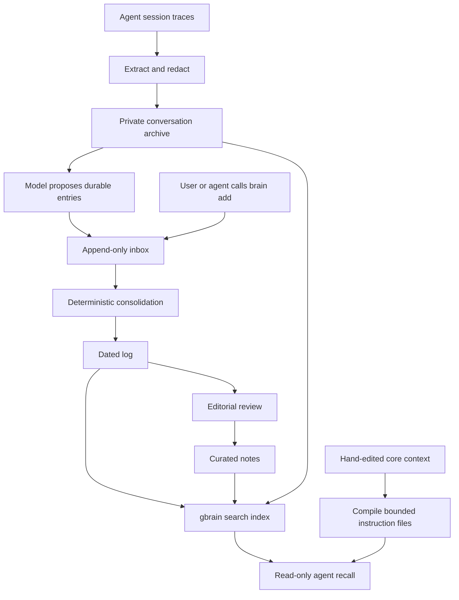

# Safa's second-brain architecture

This describes the private second brain's configured workflow as of 2026-11-10. It is a reference for Pegasim's design. See [Architecture](architecture.md) for the proposed shared system and [Source inventory](source-inventory.md) for code provenance.

## The three layers

1. **Always-loaded context.** Small, hand-edited Markdown files in `core/src/` hold stable instructions and pointers. A deterministic compiler generates a size-capped digest and agent instruction files. Multiple AI tools load the same instructions through their adapters.
2. **Conversation archive.** An extractor reads session traces from tools such as Claude Code, Codex and OpenCode. It keeps user and assistant text and compact tool-call descriptions, drops tool outputs, reasoning and images, and applies redaction before writing Markdown. The redacted archive is a separate private repository synchronized between the laptop and VPS. Redaction reduces exposure, and conversation text still needs to be treated as private.
3. **Curated knowledge.** The private `second-brain` repo holds Markdown notes, indexes, a timeline and a dated log. Curated pages organize durable conclusions. Dated log entries preserve the context, decision or result, evidence and any next action. Git provides version history. The VPS search index is derived from the notes and archive and can be rebuilt from them.

## How information moves

- **Capture.** The extractor runs on the machine that holds the traces. Scheduled jobs sync the redacted archive to the VPS. The laptop syncs the private notes repo with the VPS hub and its private GitHub remote. The conversation archive stays on the private laptop/VPS path.
- **Propose.** On the laptop, a scheduled distiller reads new portions of idle conversations and asks a configured model to propose durable entries. The distiller can call a model provider with transcript excerpts. Its output goes through `brain add`, the same validated path available to users and agents. Each entry has its own file, so concurrent writers can append independently.
- **File and curate.** A scheduled VPS job runs `brain consolidate`. The consolidator validates, redacts, deduplicates and files pending entries under `notes/log/`, then marks the inbox files as processed. This step is deterministic. Consolidation makes an entry part of the dated log. Promoting it into a curated topic page is a separate editorial decision.
- **Index and read.** The VPS imports notes and conversations into gbrain and computes embeddings separately. Newly imported material can be found by keyword before its semantic index catches up. Agents use MCP recall for depth and the generated core files for their always-loaded context. The configured recall route is read-only. Durable writes go through the inbox.
- **Handle files separately.** Binary originals live in a private asset store outside the notes repo. An explicit import can create a searchable Markdown card containing a hash, pointer and optional description. Agents can locate the original when they need to inspect it. Model-generated descriptions are separate from user-verified facts.

## What Pegasim can reuse

- **Source adapters.** The conversation extractor is the most concrete starting point. The included snapshot can be evaluated on synthetic traces as one input beside a second source. Keep source, timestamp and stable record IDs through import so retrieved answers can cite evidence.
- **Separate evidence from interpretation.** Preserve source records independently of model summaries and curated facts. The inbox and dated log show how multiple agents can propose changes with provenance while one deterministic process handles filing. Consider that pattern if the first experiment needs memory writes.
- **Keep retrieval replaceable.** Separate the canonical records from the search index and keep the read interface small. gbrain implements retrieval in Safa's installation. The first Pegasim experiment can choose the simplest retrieval that lets both collaborators check an answer against its sources.
- **Treat deployment as an implementation choice.** The current laptop/VPS schedule, harness setup and model prompts serve one person's installation. Pegasim can test the useful parts with synthetic data first and make its own decisions about storage, scheduling and remote processing.

Source references in the private second brain are `README.md`, `tools/extract/README.md`, `tools/distill/brain_distill.py`, `tools/brain/README.md`, `tools/compile/compile_core.py`, and the scheduled jobs under `ops/laptop/` and `ops/gbrain/`. The shared design depends on the concepts described here and can adopt specific code when an experiment calls for it.
